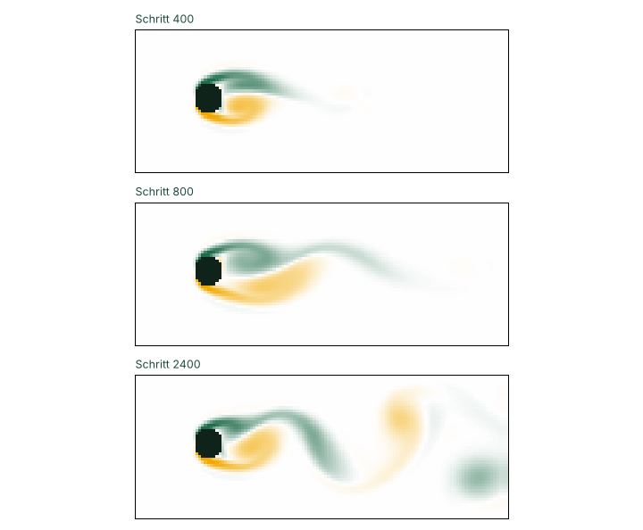

# Excel-Strömung: Kármánsche Wirbelstraße

Eine Excel-Tabelle, die die Strömung um einen Zylinder berechnet. Hinter dem Zylinder lösen sich abwechselnd Wirbel ab (Kármánsche Wirbelstraße). Jede Gitterzelle ist eine Excel-Formel, VBA ist nur für die Knöpfe nötig.



| Datei | Inhalt |
|---|---|
| `Wirbelstrasse.xlsx` | Die Simulation. Läuft ohne Makros: **F9 = 1 Zeitschritt** |
| `Wirbelstrasse.bas` | Optionales VBA-Modul mit den Makros Starten / Anhalten / Zuruecksetzen / Einzelschritt |
| `web/wirbelstrasse.html` | Browser-Version (auch fürs Tablet): Datei im Browser öffnen, läuft sofort |
| `tools/build_workbook.py` | Python-Skript, das die Excel-Datei erzeugt (z. B. für ein anderes Gittermaß) |

## Browser-Version

`web/wirbelstrasse.html` rechnet dasselbe Verfahren live auf einem feineren Gitter (200 × 80). Es gibt fünf Modelle: Zylinder, Flügel (NACA 2412 mit Anstellwinkel), Kuh als Pixelart, Auto und Cybertruck. Rauchfäden zeigen die Anströmung vom Einlass bis hinter das Modell. Dazu kommen Regler für Re und Größe, drei Ansichten (Wirbelstärke, Stromlinien, Tempo) und eine Messsonde mit Strouhal-Zahl. Das Modell lässt sich mit dem Finger verschieben.

## Schnellstart (ohne Makros)

1. Excel schließen und **nur** `Wirbelstrasse.xlsx` öffnen. Excel übernimmt die Rechen-Einstellungen von der zuerst geöffneten Mappe.
2. Unter *Datei → Optionen → Formeln* prüfen: **Manuell** berechnen, **Iterative Berechnung aktivieren**, maximale Iterationszahl **1**.
3. Auf dem Blatt `Strömung` die gelbe Zelle **Reset** von 1 auf **0** setzen.
4. **F9 gedrückt halten.** Nach etwa 600 bis 800 Schritten fängt der Nachlauf an zu pendeln, danach lösen sich die Wirbel regelmäßig ab.

Neustart: Reset auf 1, einmal F9, Reset wieder auf 0.

## Mit Knöpfen (Makros)

1. *Speichern unter* → **Excel-Arbeitsmappe mit Makros (.xlsm)**
2. `Alt+F11` → *Datei → Datei importieren…* → `Wirbelstrasse.bas`
3. *Entwicklertools → Einfügen → Schaltfläche* und je ein Makro zuweisen: `Starten`, `Anhalten`, `Zuruecksetzen`, `Einzelschritt`. Ohne Knöpfe geht es auch über `Alt+F8`.

Das Makro rechnet die Blöcke ausdrücklich in der richtigen Reihenfolge (`Range.Calculate`). Mit **Schritte pro Bild** stellst du ein, wie viele Zeitschritte zwischen zwei Bildschirm-Updates gerechnet werden.

## Wie es funktioniert

Gelöst wird die 2D-Navier-Stokes-Gleichung in der Wirbelstärke-Stromfunktion-Form:

```
∂ω/∂t + u·∇ω = ν∇²ω        ∇²ψ = −ω        u = ∂ψ/∂y,  v = −∂ψ/∂x
```

Das Gitter hat 130 × 50 Zellen. Der Zylinder hat D = 10 Zellen, es gilt U∞ = 1, Re = 150 und Δt = 0.1. Auf dem Blatt `Rechnung` stehen die Blöcke **untereinander**, und zwar in der Reihenfolge eines Zeitschritts:

| Block | Formel (Prinzip) |
|---|---|
| `MASK` | `=IF((i−x₀)²+(j−y₀)² ≤ R², 1, 0)`: zeichnet den Zylinder |
| `NF` | Anzahl der Fluid-Nachbarn (für die Wandwirbelstärke) |
| `W0` | ω alt = Kopie von ω neu aus dem letzten Schritt |
| `U`, `V` | Geschwindigkeit aus den Differenzen von ψ |
| `W1` | ω neu = ω alt + Δt·(−Transport + ν·Diffusion). Der Transport läuft als Upwind 2. Ordnung in Strömungsrichtung. Am Zylinder gilt die Thom-Formel ω = 2(ψ_K − ψ_Nachbar) |
| `PSI` | ψ = (Summe der 4 Nachbarn + ω)/4, überrelaxiert mit β. Pro Schritt gibt es einen Sweep, weil sich ψ nur langsam ändert |

**Der Trick:** Mit aktivierter iterativer Berechnung dürfen sich Zellen gegenseitig im Kreis referenzieren, z. B. `W0 → W1 → W0`. Jede Neuberechnung ist dann genau ein Zeitschritt.

**Ränder:** Am Einlass links gilt ψ = U∞·y und ω = 0. Oben und unten liegen reibungsfreie Wände. Am Auslass rechts gilt ∂/∂x = 0. Der Zylinder sitzt eine halbe Zelle außerhalb der Kanalmitte, damit die Symmetrie bricht und das Ablösen von selbst beginnt.

**Stabilität:** Das explizite Euler-Verfahren mit Upwind 2. Ordnung braucht etwas echte Viskosität, grob gilt Δt < 2ν/U∞². Wenn die Farben explodieren oder `#ZAHL!` erscheint, Δt verkleinern und Reset drücken.

## Zum Ausprobieren

- **Re = 30:** Der Nachlauf bleibt ruhig und symmetrisch, es lösen sich keine Wirbel ab.
- **Re = 100 bis 200:** Es entsteht eine schöne Wirbelstraße. Die Periode liegt bei etwa 600 Schritten, das entspricht einer Strouhal-Zahl von etwa 0.17.
- Den Zylinder verschieben (x₀, y₀) oder D ändern, danach Reset.

## Datei neu erzeugen

```bash
pip install openpyxl
python tools/build_workbook.py Wirbelstrasse.xlsx
```

Die Gittergröße steht oben im Skript (`NX`, `NY`).
